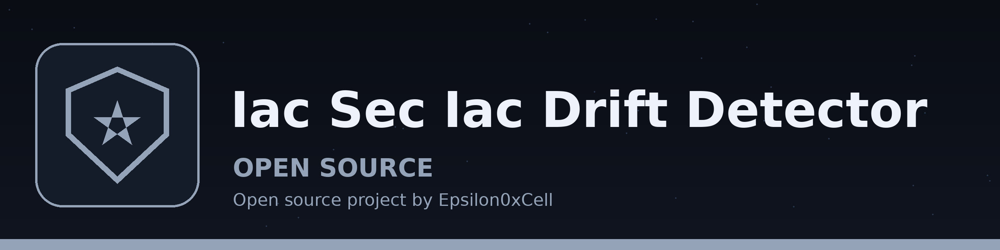

# iac-sec-IaC-Drift-Detector
Compares an IaC template file with a state file and reports each differing path with the template value and the state value, so a report names the resource and field that changed instead of only saying the two files differ. The exit code is 1 when drift is found and 0 when the two sides match, so a script or CI step can gate on the result. Dependencies: `PyYAML` and `jsonpath_ng`, listed in requirements.txt. The template file must be YAML or JSON. The provider flag selects how the state file is read: terraform state files are read as JSON, and pulumi and kubernetes state files are read as JSON or YAML, matching the file extension. No provider CLI is called; the state comes from the file given with -s.

## Install
`git clone https://github.com/ShadowStrikeHQ/iac-sec-iac-drift-detector`

## Usage
`python3 main.py -t template.yaml -p terraform -s state.json -o drift_report.txt`

## Parameters
- `-h`: Show help message and exit
- `-t`: Path to the IaC template file (YAML or JSON)
- `-p`: Provider: terraform, pulumi, or kubernetes (selects how the state file is read)
- `-s`: Path to the state file
- `-o`: Output file for the drift report (default: drift_report.txt). It may not be the template or state file; the run refuses at exit 1 rather than overwrite an input.
- `-j`: JSONPath expression applied to both the template and the state before comparing (optional)

## License
Copyright (c) ShadowStrikeHQ
